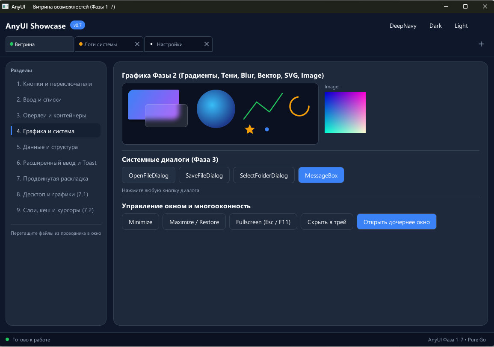
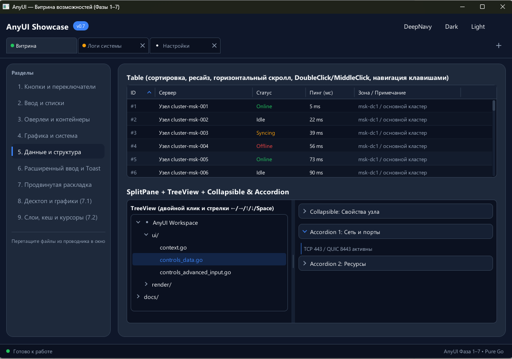
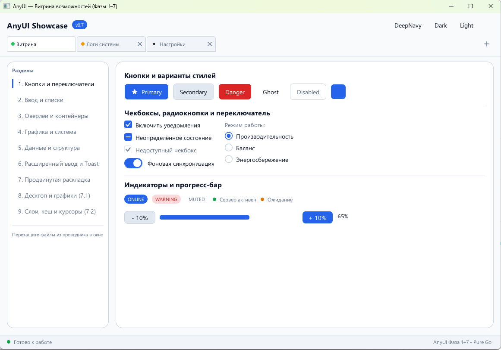
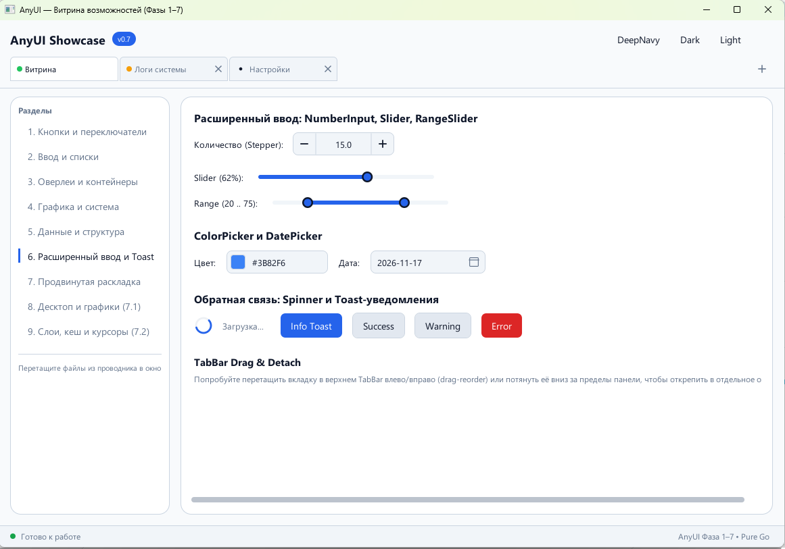

**English** | [Русский](README.ru.md)

# AnyUI (`anyui`)

[](LICENSE)
[](go.mod)
[-success.svg)](#platform-support)

A lightweight, embeddable cross-platform Go UI framework powered by a pure-Go software 2D renderer — **no WebView2, no OpenGL/GPU, and no CGO** on Windows and Linux.

Designed for desktop tools, system utilities, background services with a tray icon, and environments without hardware acceleration (servers, VMs, RDP, SSH X11 forwarding).

---

## Screenshots

| | |
| :---: | :---: |
|  |  |
|  |  |

---

## Key Features

- **Zero Idle CPU Usage:** the OS event loop sleeps until woken by user input, `App.Dispatch`, or active animations.
- **Software 2D Renderer (`render`):** anti-aliased SDF primitives, linear/radial gradients, soft shadows (`BoxShadow`), backdrop blur, SVG icon rasterization with tinting, LRU glyph/image caches, and dirty-rectangle presentation.
- **Pure Go on Windows & Linux (`CGO_ENABLED=0`):** builds compact standalone binaries (3–5 MB) with zero external runtime dependencies.
- **Rich Widget Set (`ui`):** Immediate Mode API with `Button`, `TextInput`, `MaskedInput`, `TextArea`, `Select`, `MultiSelect`, `Table`, `TreeView`, `ListView`, `TabBar`, `MenuBar`, `Toolbar`, `StatusBar`, `LogView`, charts (`Sparkline`, `LineChart`, `BarChart`), `DatePicker`, `TimePicker`, `ColorPicker`, `Modal`, `Drawer`, `SplitPane`, and more.
- **Flexible Layout & Styling:** `Row`, `Column`, `RowFlex`, `ColumnFlex`, `Grid`, `FormLayout`, `Flow`, `ScrollView`, `Card`, `Page`, built-in themes (`NavyTheme`, `DarkTheme`, `LightTheme`, `SystemTheme`), and functional `Option` modifiers.
- **System Integration (`platform`):** system tray, native notifications, file/folder/message dialogs, text & image clipboard, file Drag & Drop, `Frameless` / custom `TitleBar`, `SingleInstance`, `WindowState` persistence, multi-window support, and `i18n`.

---

## Platform Support

| Platform | Backend | CGO | Status |
| --- | --- | --- | --- |
| **Windows** (10 / 11 / Server) | Win32 + GDI + DWM | `CGO_ENABLED=0` | Supported |
| **Linux (X11)** | `xgb` + MIT-SHM / PutImage | `CGO_ENABLED=0` | Supported |
| **Linux (Wayland)** | Native Wayland (`wl_shm`, `xdg_shell`) | `CGO_ENABLED=0` | Supported |
| **macOS** | Cocoa / AppKit | `CGO_ENABLED=1` | Supported |
| **Android** | NDK + `NativeActivity` | `CGO_ENABLED=1` | Planned |

---

## Benchmarks

Minimal `480x320` window (label, text input, click counter button) measured on **Windows 11 Pro (64-bit), AMD Ryzen 5 5600G (12 logical CPUs), 31.4 GB RAM, `go1.26.2 windows/amd64`** after 5s warmup over a 5s idle window (including child processes such as WebView2):

| Framework | CGO | Binary Size | Startup Time | Processes | Working Set (RAM) | Private Memory | Idle CPU |
| --- | :---: | ---: | ---: | ---: | ---: | ---: | ---: |
| **AnyUI** | `0` | **2.95 MB** | **22.82 ms** | **1** | **38.82 MB** | **25.55 MB** | **0%** |
| **Gio** | `0` | 6.52 MB | 170.28 ms | 1 | 55.34 MB | 39.39 MB | 0% |
| **Fyne** | `1` | 23.29 MB | 250.43 ms | 1 | 166.21 MB | 158.45 MB | 0% |
| **Wails** | `0` | 10.66 MB | 515.67 ms | 7 | 399.33 MB | 193.79 MB | 0% |

- **WebView2 Runtime (required by Wails):** `878.0 MB` (`v157.0.4341.60`) on disk.
- Reproduce on your own machine: see [benchmarks/](benchmarks/README.md) (`.\run.ps1`).

---

## Quick Start

```bash
go get github.com/kirpicheff/anyui
```

```go
package main

import (
	"log"

	"github.com/kirpicheff/anyui"
)

func main() {
	app := anyui.NewApp(anyui.Config{
		Title:  "My App",
		Width:  960,
		Height: 600,
		Theme:  anyui.NavyTheme(),
	})

	name := ""
	enabled := true

	err := app.Run(func(ui *anyui.UI) {
		ui.Padding(20, func() {
			ui.Column(12, func() {
				ui.Label("Settings", anyui.FontSize(18), anyui.Bold())
				ui.TextInput("inp_name", &name, "Enter name", anyui.Width(260))
				ui.Toggle("tgl_on", "Enable notifications", &enabled)
				if ui.Button("btn_save", "Save", anyui.Primary()) {
					log.Println("Saved:", name, enabled)
				}
			})
		})
	})
	if err != nil {
		log.Fatal(err)
	}
}
```

To run the interactive widget showcase:

```bash
go run ./cmd/demo
```

---

## Documentation

- [Overview & Architecture](docs/en/README.md)
- [Widgets & Layout](docs/en/widgets.md)
- [Graphics & 2D Rendering](docs/en/graphics.md)
- [Themes & Styling](docs/en/theming.md)
- [System Integration (Windows, Tray, Dialogs, Linux)](docs/en/system.md)
- [Testing & Headless Runtime](docs/en/testing.md)
- [Units & Typing (Dp / Px)](docs/en/units.md)

You can also inspect the Go API directly from the terminal:

```bash
go doc .
go doc -all .
```

---

## Support the Project

AnyUI is developed in my free time. If it saved you hours of work and RAM, you can buy me a coffee:

- [Support via Tribute (International: Cards, Apple/Google Pay)](https://web.tribute.tg/d/Ung)
- [Support via Boosty (RU)](https://boosty.to/artemalabin/donate)

---

## License

Licensed under the [Apache License 2.0](LICENSE). See [NOTICE](NOTICE) for attribution details.
