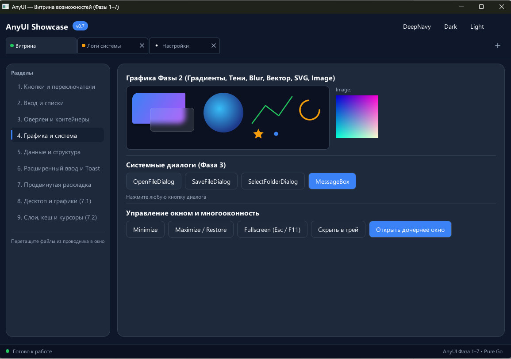
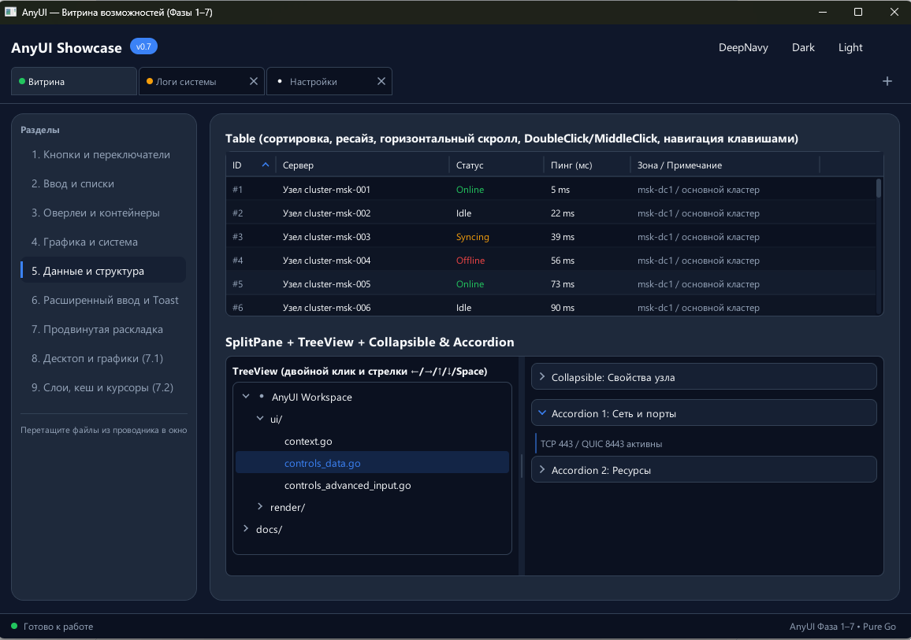
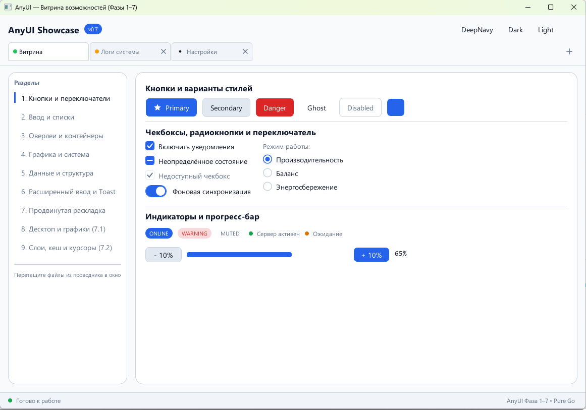
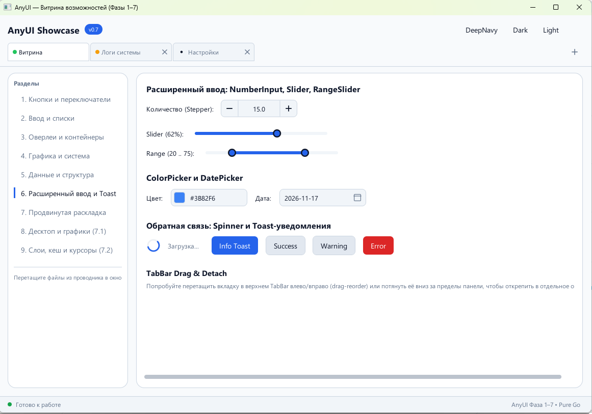

[English](README.md) | **Русский**

# AnyUI (`anyui`)

[](LICENSE)
[](go.mod)
[-success.svg)](#поддержка-платформ)

Лёгкий, встраиваемый кроссплатформенный UI-фреймворк на Go с программным 2D-рендерингом — **без WebView2, без OpenGL/GPU и без CGO** на Windows и Linux.

Подходит для десктопных утилит, системных сервисов с иконкой в трее и сред без аппаратного ускорения (серверные ОС, VM, RDP, SSH X11-forwarding).

---

## Скриншоты

| | |
| :---: | :---: |
|  |  |
|  |  |

---

## Ключевые особенности

- **~0% нагрузки на CPU в простое:** цикл событий ОС спит до появления пользовательских событий, `App.Dispatch` или активных анимаций.
- **Программный 2D-рендерер (`render`):** сглаженные SDF-примитивы, линейные и радиальные градиенты, мягкие тени (`BoxShadow`), размытие фона, растеризация SVG-иконок с покраской, LRU-кеши глифов и изображений, частичная перерисовка (dirty rectangles).
- **Чистый Go на Windows и Linux (`CGO_ENABLED=0`):** компактный бинарник (3–5 МБ) без внешних зависимостей.
- **Богатый набор виджетов (`ui`):** Immediate Mode API с `Button`, `TextInput`, `MaskedInput`, `TextArea`, `Select`, `ComboBox`, `MultiSelect`, `Table`, `TreeView`, `ListView`, `TabBar`, `MenuBar`, `Toolbar`, `StatusBar`, `LogView`, графиками (`Sparkline`, `LineChart`, `BarChart`), `DatePicker`, `TimePicker`, `ColorPicker`, `Modal`, `Drawer`, `SplitPane` и др.
- **Гибкая раскладка и стилизация:** `Row`, `Column`, `RowFlex`, `ColumnFlex`, `Grid`, `FormLayout`, `Flow`, `ScrollView`, `Card`, `Page`, готовые темы (`NavyTheme`, `DarkTheme`, `LightTheme`, `SystemTheme`) и функциональные опции `Option`.
- **Системная интеграция (`platform`):** системный трей, уведомления ОС, нативные диалоги файлов/папок/сообщений, буфер обмена (текст и изображения), Drag & Drop файлов, режим `Frameless` / виджет `TitleBar`, `SingleInstance`, сохранение `WindowState`, многооконность и `i18n`.

---

## Поддержка платформ

| Платформа | Бэкенд | CGO | Статус |
| --- | --- | --- | --- |
| **Windows** (10 / 11 / Server) | Win32 + GDI + DWM | `CGO_ENABLED=0` | Поддерживается |
| **Linux (X11)** | `xgb` + MIT-SHM / PutImage | `CGO_ENABLED=0` | Поддерживается |
| **Linux (Wayland)** | Нативный Wayland (`wl_shm`, `xdg_shell`) | `CGO_ENABLED=0` | Поддерживается |
| **macOS** | Cocoa / AppKit | Планируется (`CGO`) | В планах |

---

## Бенчмарки

Минимальное окно `480×320` (заголовок, текстовое поле, кнопка со счётчиком), замерено на **Windows 11 Pro (64-bit), AMD Ryzen 5 5600G (12 потоков), 31.4 GB RAM, `go1.26.2 windows/amd64`** после 5 с прогрева за 5 с простоя (с учётом дочерних процессов вроде WebView2):

| Фреймворк | CGO | Размер бинарника | Время старта | Процессы | Working Set (RAM) | Private Memory | Idle CPU |
| --- | :---: | ---: | ---: | ---: | ---: | ---: | ---: |
| **AnyUI** | `0` | **2.94 MB** | **22.08 ms** | **1** | **38.74 MB** | **25.55 MB** | **0%** |
| **Gio** | `0` | 6.52 MB | 151.90 ms | 1 | 55.71 MB | 39.31 MB | 0% |
| **Fyne** | `1` | 23.29 MB | 223.11 ms | 1 | 169.45 MB | 156.94 MB | 0% |
| **Wails** | `0` | 10.66 MB | 743.26 ms | 7 | 394.67 MB | 191.37 MB | 0% |

- **WebView2 Runtime (требуется для Wails):** `878.0 MB` (`v157.0.4341.60`) на диске.
- Воспроизвести на своей машине: см. [benchmarks/](benchmarks/README.md) (`.\run.ps1`).

---

## Быстрый старт

```bash
go get github.com/kirpicheff/anyui
```

```go
package main

import (
	"log"

	"github.com/kirpicheff/anyui"
)

func main() {
	app := anyui.NewApp(anyui.Config{
		Title:  "My App",
		Width:  960,
		Height: 600,
		Theme:  anyui.NavyTheme(),
	})

	name := ""
	enabled := true

	err := app.Run(func(ui *anyui.UI) {
		ui.Padding(20, func() {
			ui.Column(12, func() {
				ui.Label("Настройки", anyui.FontSize(18), anyui.Bold())
				ui.TextInput("inp_name", &name, "Введите имя", anyui.Width(260))
				ui.Toggle("tgl_on", "Включить уведомления", &enabled)
				if ui.Button("btn_save", "Сохранить", anyui.Primary()) {
					log.Println("Сохранено:", name, enabled)
				}
			})
		})
	})
	if err != nil {
		log.Fatal(err)
	}
}
```

Запуск интерактивной витрины виджетов:

```bash
go run ./cmd/demo
```

---

## Документация

- [Обзор и архитектура](docs/ru/README.md)
- [Виджеты и раскладка](docs/ru/widgets.md)
- [Графика и 2D-рендеринг](docs/ru/graphics.md)
- [Темы и стилизация](docs/ru/theming.md)
- [Системная интеграция (окна, трей, диалоги, Linux)](docs/ru/system.md)
- [Тестирование и Headless-рантайм](docs/ru/testing.md)
- [Единицы измерения и типизация (Dp / Px)](docs/ru/units.md)

Для просмотра справочника API из терминала:

```bash
go doc .
go doc -all .
```

---

## Поддержать проект

AnyUI разрабатывается в свободное время. Если фреймворк сэкономил вам часы работы и сотни мегабайт RAM, вы можете угостить автора кофе:

- [Поддержать через Boosty (РФ: карты, СБП)](https://boosty.to/artemalabin/donate)
- [Поддержать через Tribute (зарубежные карты, Apple/Google Pay)](https://web.tribute.tg/d/Ung)

---

## Лицензия

Распространяется под лицензией [Apache License 2.0](LICENSE). См. [NOTICE](NOTICE) для информации об авторстве.

